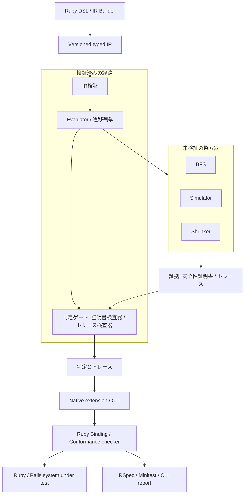

# Ruby-native Executable Specification & Model Checking

設計仕様書（Draft 0.5、検証済みの判定経路とRails適用）

## 1. 概要

Rubyで実行可能な形式仕様を記述し、Rust製の独立した検証エンジンでシミュレーションおよびモデル検査を行う。生成した操作列をRuby/Railsの実装に適用し、仕様と実装の適合性を検査する。

新規設計とし、既存の仕様言語、テストライブラリ、トレース形式、アダプターAPIとの互換性を前提としない。Ruby利用者の記述量と検証時のフィードバックを起点に設計する。外部のモデル検査ツールやNode.jsは不要とする。

本書のAPI、型名、crate名、既定値は設計案であり、既存実装の仕様ではない。プロジェクト名はfmspecとする。

## 2. 目的と非目的

### 2.1 目的

- Rubyに自然に埋め込める宣言型DSLによる状態遷移仕様の記述。
- 有限の到達可能状態空間に対する不変条件の網羅的検査。
- 非決定的選択を含むランダムシミュレーションと反例生成。
- Ruby/Railsの実装に対するModel-Based Testing（MBT）。
- 再現可能なトレース、反例の縮小、回帰テストへの転用。
- Coding Agentが仕様、Binding、テストを作成・変更しやすい設計。
- Rustエンジンのホスト言語非依存性と、判定を返す経路の機械検証。性能・機能数より保証の明確さを優先する。
- Railsの業務契約、拒否、障害、履歴、並行処理を有限の遷移系として検証する。

### 2.2 非目的（初期版）

- 任意のRubyプログラムの形式検証、自動的なRubyコードの仕様への変換。
- 既存の形式仕様言語との構文・API互換性。
- SMTによる記号的検証、一般的な時相論理・非有界活性・公平性の検証（有界応答性は別途対応）。
- 実際のRailsアプリケーション全体の正しさの証明。
- 無限状態空間の網羅的探索の保証。

## 3. アーキテクチャ



| コンポーネント | 言語 | 正しさの根拠 | 責務 |
|---|---|---|---|
| DSL / IR Builder | Ruby | テスト | 宣言、式の構築、位置情報、利用者向け診断 |
| Core | Rust / Verus | 証明 | IR検証、型、値、意味論、遷移列挙 |
| 判定ゲート | Rust / Verus | 証明 | 安全性証明書とトレースの検査、判定の決定 |
| Search | Rust | テスト | BFS、シミュレーション、縮小、制限、統計。証拠を生成する |
| Extension | Rust / Nupur | lintとテスト | Rubyとの値の受け渡し、GVLの解放、例外への変換 |
| CLI | Rust | テスト | IRとトレースのバッチ処理 |
| Binding | Ruby | テスト | 実装の操作、観測、状態比較、隔離 |
| Integration | Ruby | テスト | RSpec、Minitest、Rails、Agent向け出力 |

Rust coreはRubyのVALUEやGVLを知らない独立crateとする。
探索のホットループではRubyへのコールバックを行わない。
Pure Rubyの完全な第二Evaluatorは初期要件としないが、§14.3の比較テストに使う小さな参照実装を用意する。

中核MVPはCLIから利用する。
Ruby向けMVPでは、native extensionが同じcrateを呼び出す（§3.2）。
Rubyからの通常の利用でCLIのプロセスを起動することはない。

### 3.1 検証済みの経路と未検証の経路

利用者が受け取る判定の意味は、**判定ゲート**だけで決まる。
判定ゲートは、モデルと**証拠**（安全性証明書、またはトレース）を受け取り、証拠を検査してから判定を返す検証済みの関数である。
探索器（BFS、シミュレータ、縮小器）は証拠を生成するだけで、判定を直接返さない。

- `Verified` は、検査器が証明書を受理した後にだけ返す。
- `Violated` と `Error`（モデルの評価エラー）は、検査器がトレースを再生して受理した後にだけ返す。
- 探索器が生成した証拠を検査器が拒否した場合は `InternalError` とする。これは探索器の不具合を示す。
- 資源上限で探索または検査が完了しなかった場合は `Inconclusive` とする。

この境界があるため、探索器に不具合があっても誤った `Verified` や `Violated` は返らない。
BFSの最適化や別の探索方式の追加も、判定の意味を変えずに行える。
その代わり、探索器の完全性、停止性、反例の最短性は証明の対象外となり、テストで検査する（§14.1.1）。

境界を保つために、次の3点を実装上の規則とする。

- **公開関数は前提条件を持たない**：Verusは、未検証コードからの呼び出しについて `requires` を検査しない。未検証コードから呼べる検証済み関数は、モデルの整形式性などの必要な条件を自分で検査し、満たさない入力には `InvalidModel` を返す。
- **判定の値は検証済み側でしか構築できない**：判定の型はフィールドを非公開にし、未検証コードが `Verified` を直接作れないようにする。
- **探索器は検証済みcrateの外に置く**：Verusは `verus!` ブロック内の実行ループに `decreases` を要求する。未検証の探索器は別crateとし、crateの依存関係を境界に一致させる。

### 3.2 RubyとRustの境界

Ruby向けの配布物は、Rustのcrateをnative extensionとして同梱したgemとする。
Ruby C APIとのやりとりには、Makiriのバインディング層であるNupurを流用する。
Nupurは、raiseがRustの後始末を飛び越えないこと、panicがCに到達しないこと、GVLの保持を値で示すことを、型とcrateの依存関係とlintで保証する。

拡張が公開するRubyオブジェクトは次の2種類とする。

- **Model**：IRのJSON文字列を受け取り、Rust側で検証してから包んだ不変のオブジェクト。`check` と `simulate` は、GVLを解放した状態でこのオブジェクトを読み取る。
- **Session**：MBTの1ケース分の候補状態集合を保持するオブジェクト（§11.4）。操作はGVLを保持したまま行う。

境界の設計は次の規則に従う。

- IR、証拠、結果、トレースは、いずれもJSON文字列で受け渡す。CLIと拡張が同じ直列化を使うので、交換形式のテストを共有できる。拡張が使うRuby C APIも、文字列の読み書き、オブジェクトの定義、例外に限られる。
- ペイロードはRubyの値を保持しない。ソース位置や名前は、IRに含まれる整数と文字列として持つ。
- 拡張はRubyのブロックやメソッドを呼び出さない。`command` と `observe` のブロックはRuby側のドライバが実行し、結果の値だけを拡張に渡す。
- 探索と証拠の検査は、NupurのGVL解放（`without_gvl_cancellable`）の内側で実行する。探索器は一定のステップごとに中断要求を確認して打ち切る。割り込みはRubyの例外として伝わり、例外が発生しなかった場合は `Inconclusive` を返す。
- Rustのpanicは拡張の内部エラーの例外に変換する。そのため、プロファイルは `panic = "unwind"` とする。

Nupurは公開crateではなく、Makiriのワークスペース内で使う前提で書かれている。
そこで、Makiriの特定コミットにおけるNupur（`nupur` と `nupur_sys` のソースとマニフェスト）の写しをgemに同梱する。
写しを同梱すれば、ソースインストール時にネットワークもMakiriのリポジトリも必要としない。
固定するコミットは段階4の着手時に決め、更新のたびに差分をレビューする。

写しの運用は次の規則に従う。

- 写しをローカルで編集しない。変更が必要な場合はMakiri側で行い、固定するコミットを上げる。
- 写しの各ファイルが固定したコミットの内容と一致することを、CIで検査する。固定したコミットでMakiri側の検査が通っている限り、Makiri側の証明（`nupur_sys` の整数変換など）は写しにもそのまま当てはまる。
- 型で表せないNupurの規則は、Makiriの `nupur_lints` を拡張に対して実行して検査する（§14.3）。lintそのものは写さず、Makiriのチェックアウトを参照する。
- Nupurが前提とするビルド設定（ワークスペースのlint設定、`panic = "unwind"`、clippyの `large-error-threshold`）を、こちらのワークスペースに用意する。

拡張の都合でNupurのAPIを増やす必要が生じた場合、またはNupurの変更が落ち着いた場合は、独立したcrateへの切り出しを検討する。

## 4. 仕様記述DSL

### 4.1 設計原則と利用者向けAPI

最も頻繁に使う操作が短く記述できることを優先する。仕様の構築時にRubyブロックを実行して型付きIRを生成し、探索時には任意のRubyコードを呼び出さない。Rubyの名前空間は `Fmspec` とする。

```ruby
Tickets = Fmspec.define(:tickets) do
  state :sold, int(0..4), initial: 0
  constant :capacity, 3

  action :purchase, quantity: 1..2 do |s, quantity|
    guard s.sold + quantity <= s.capacity
    update sold: s.sold + quantity
  end

  action :cancel do |s|
    guard s.sold > 0
    update sold: s.sold - 1
  end

  invariant(:capacity_respected) { |s| s.sold <= s.capacity }
end

Tickets.check(max_states: 10_000)
```

チケットの販売上限は3枚で、状態型は4枚まで表現できる。上のモデルでは0〜3枚に到達し、検査結果は `Verified` となる。購入のguardだけを削除すると、2枚ずつ2回購入して4枚に達し、`capacity_respected` の最短反例を得る。5枚への更新は状態型の範囲外で評価エラーになる。各ケースを独立に検査する条件を§17.1.1に示す。

- `s` は読み取り専用の記号的な現在状態であり、定数も名前で参照できる。実際のRubyオブジェクトではない。
- actionの引数は宣言した有限ドメインから列挙する。動的ドメインは後続の拡張とする。
- `guard` を省略すれば常に有効。`update` は同時代入で、書かれていない変数は維持する。
- 算術・比較演算子は式ノードを構築する。等価性は `eq` / `ne`、論理積・論理和は `&` / `|`（括弧必須）、否定は `not_`、条件式は `ite` を使用する。
- Rubyの `if`、`&&`、`||`、`!`、`==` を記号式に適用しない。Prism等による構文検査を導入し、記号的ブロック内での誤用を診断する。構文検査を実装するまでは公開DSLの許容構文を限定し、検査できないブロックは拒否する。
- 定数の組み立てや静的な仕様生成には通常のRubyを利用できる。任意のRubyコードの純粋性を保証するものではない。
- 型の推論はリテラルと有限ドメインから開始し、曖昧な場合は明示型を要求する。

基本操作に専用の `step` 定義やaction一覧の再記述を要求しない。すべてのactionを既定で探索対象とする。対象操作の限定は探索設定として別途指定する。

### 4.1.1 利用フロー

1. 状態と業務上の操作を記述する。
2. 不変条件を追加して、実装なしで `check` を実行する。
3. 実装ができたら、操作と観測値を小さなbindingで接続する。
4. `test` で操作列を生成・実行し、不一致があれば最小化された再現手順を得る。
5. 反例を固定テストに保存し、仕様変更時は古い反例の意味を再検査する。

単純なモデルで数十行の補助クラスやJSONの手書きを必要としないことをUX上の受入基準とする。

### 4.2 型と演算

| 分類 | 初期対応 |
|---|---|
| 基本型 | Bool、有界Int、Enum（Stringは有限列挙のラベルに限定） |
| 複合型 | Tuple、Record、Option。有限Set/Map、有界Listは段階的に追加 |
| 算術 | add、sub、mul、比較、必要に応じて div/mod |
| 論理 | all、any、not、implies、eq |
| 集合・写像 | contains、union、difference、get、put、keys |
| 量化 | 有限集合上の forall、exists |
| 条件式 | ite(condition, then, else) |

Intは初期版では明示した有限範囲を持つ符号付き64ビット整数とし、オーバーフローを検出して評価エラーとする（循環させない）。範囲外の状態更新は評価エラーとし、遷移を黙って除外しない。中間演算の範囲と状態型の範囲を区別する。任意精度整数は将来の拡張候補。除算・剰余を追加する際は負数を含む意味論を明文化する。集合は重複なし、Mapのキーは一意とする。未定義キーへのアクセス等は評価エラーとし、黙ってnilに変換しない。

全ての枝を静的に型検査したうえで、実行時には次の順序で評価する。

- `ite(c, x, y)` は条件に続いて選ばれた一方の枝だけを評価する。
- `all` と `any` はオペランドを記述順に評価し、それぞれ最初の偽・真で打ち切る。`&` と `|` はこの規則に従う二項のIR式を構築する。`implies(p, q)` は前件が偽なら真を返し、前件が真のときだけ後件を評価する。
- 実際に評価した部分式のエラーは呼び出し元へ伝播する。

## 5. 形式意味論

モデルを `(S, I, L, T, P, Q)` とする。

- `S`：型付き状態の集合。
- `I ⊆ S`：初期状態の集合。MVPでは単一初期状態。複数初期状態は後続拡張だが証明書の定義は一般化する。
- `L`：具体的な遷移ラベル `(a, k, r)` の集合。`a` は操作名と公開引数、`k` は内部選択の割当て（選択なしは空）、`r` は宣言した出力（出力宣言なしは専用の無出力値）。
- `T ⊆ S × L × S`：遷移関係。
- `P`：名前付きの状態不変条件。
- `Q`：名前付きの遷移述語（前状態・具体的な遷移ラベル・後状態に適用する契約）。

到達可能な状態は、初期状態から有限回の遷移で到達できる状態である。安全性検査はすべての到達可能状態で各不変条件が真であることを確認する。

### 5.1 遷移の評価規則

1. 現在状態を不変な値として扱う。
2. 各actionについて、宣言順に有限の選択ドメインを評価し、引数の組を列挙する。動的ドメイン対応後は後続のドメインが先行する引数を参照できる。
3. guardが偽の組は無効とし、その組の更新式・出力式・遷移契約を評価しない。
4. guardが真の組について、すべての代入式と出力式を遷移前の状態・公開入力・内部選択から評価する。
5. 更新を同時に適用して次状態を生成する。未更新変数は維持する。同一変数への重複代入は拒否する。
6. 次状態の型を検査する。探索器は状態不変条件と各遷移の契約を検査する。契約違反の遷移を列挙から除外してはならない。

非決定性は複数のactionまたは有限の選択肢として明示される。同一状態と同一の公開action・入力から複数の許容結果を生成できる。内部選択を含む具体的な遷移は決定的とし、公開入力と内部選択を区別する。時刻、乱数、I/O、外部サービスは式内で直接評価せず、選択値または状態変数として表現する。

### 5.2 拒否とデッドロック

無効なguardは「実装が拒否すること」の仕様ではない。拒否を検査する場合は、拒否結果を記録する有効な遷移を記述する。同じ操作名の条件分岐を扱える設計とし、初期版では条件式による状態更新でも表現できる。終了状態は明示的なterminal predicateで指定する。終端でない状態に有効な遷移が存在しない場合、デッドロック検査が有効なら反例とする。

## 6. 中間表現（IR）

IRはバージョン付き、型付き、ホスト言語非依存とする。初期の交換形式はJSONとし、Rust内部では検証済みの型付き構造に変換する。

```json
{
  "ir_version": 1,
  "name": "counter",
  "states": [{"id": 0, "name": "n", "type": {"int": {"min": 0, "max": 3}}, "initial": {"int": 0}}],
  "actions": [{
    "name": "inc",
    "choices": [],
    "guard": {"lt": [{"var": 0}, {"int": 3}]},
    "updates": [{"target": 0, "expr": {"add": [{"var": 0}, {"int": 1}]}}]
  }],
  "invariants": [{"name": "bounded", "expr": {"le": [{"var": 0}, {"int": 3}]}}]
}
```

これは交換形式の例であり、完全なJSON Schemaではない。実装時に演算子、型、束縛、定数、ソース位置、エラー形式を含む正式なスキーマを定義する。

Rust側で未知のバージョン・演算子、未定義参照、型不整合、無効な束縛、重複定義を拒否する。Ruby側で検査済みであることを信頼しない。文字列名はIRロード時に内部IDへ解決する。

## 7. Rust Core API

Rust側のAPIは、検証済みの判定経路と、未検証の探索器が使うインターフェースに分かれる。
以下のコードは概念例であり、型名は仮のものである。

### 7.1 判定経路

```rust
/// IR検証を通過したモデル。フィールドは非公開で、validate だけが構築する。
pub struct CheckedModel { /* ... */ }

pub fn validate(raw: &RawModel) -> Result<CheckedModel, InvalidModel>;

pub enum Evidence {
    Certificate(Vec<EncodedState>), // 安全性証明書（状態集合）
    Trace(Trace, Claim),            // 違反または評価エラーに至るトレース
    Unavailable(Limit),             // 資源上限で証拠を得られなかった
}

/// 判定。フィールドは非公開で、decide だけが構築する。
pub struct Verdict { /* ... */ }

pub fn decide(model: &CheckedModel, conditions: &Conditions, evidence: &Evidence) -> Verdict;
```

`validate` と `decide` は前提条件を持たない。
`decide` の事後条件が、§14.1の Certificate Soundness と Trace Validity を述べる。
`Claim` は、トレースの末尾で起きる事象（不変条件の違反、遷移契約の違反、デッドロック、評価エラー）を対象とともに示す。
不変条件や契約は文字列ではなく、IRロード時に解決した内部IDで指す。

### 7.2 探索器が使うインターフェース

```rust
pub trait Model {
    type State: Clone + Eq + std::hash::Hash;
    type Label: Clone; // 公開入力・内部選択・出力
    type Error;

    fn initial(&self) -> Result<Self::State, Self::Error>;
    fn successors(
        &self,
        state: &Self::State,
    ) -> Result<Vec<(Self::Label, Self::State)>, Self::Error>;
    fn violations(&self, state: &Self::State) -> Result<Vec<PropertyId>, Self::Error>;
    fn transition_violations(
        &self,
        before: &Self::State,
        label: &Self::Label,
        after: &Self::State,
    ) -> Result<Vec<PropertyId>, Self::Error>;
    fn is_terminal(&self, state: &Self::State) -> Result<bool, Self::Error>;
}
```

探索器は、検証済みのEvaluatorと遷移列挙器を呼び出して後続状態を得る。
探索器そのものは検証しない。
探索器はRubyに依存しない。
実装規模が増えた際には、遷移の遅延列挙、StateId、arenaなどを導入できる。

### 7.3 状態の等価性と集合

検証済みの経路では、状態を型情報から決まる正規の符号化列で表し、等価性を符号化列の一致で定義する。
証明書の状態集合は符号化列を辞書順に整列した列とし、所属の判定は二分探索で行う。
整列されていない証明書は所属の判定に失敗して拒否されるだけで、誤って受理されることはない。

標準ライブラリの `HashMap` や `HashSet` に状態を直接キーとして渡す方法は、検証済みの経路では使わない。
Verusがハッシュキーとしての性質を仮定なしに認めるのは整数などの基本型に限られ、`Vec` や利用者定義の構造体をキーにするには信頼する仮定が必要になるためである。
探索器の訪問済み集合はこの制約を受けず、標準のハッシュ表を使ってよい。
有限型を混合基数で `u64` に符号化して基本型のキーにする方法は、状態空間が `u64` に収まるモデル向けの最適化として後で検討する。

## 8. 明示的状態空間探索

### 8.1 BFS（初期の標準方式）

```text
s0 = initial()
check_invariants(s0)
visited = {s0: root_id}
queue = [root_id]
while queue is not empty:
    check_time_and_memory_limits()
    current = queue.pop_front()
    for (label, next) in successors(current):
        check_transition_properties(current, label, next)
        if next is not in visited:
            if max_states is set and size(visited) == max_states:
                return Inconclusive(max_states)
            id = store(next, parent=current, label=label)
            visited[next] = id
            check_invariants(next)
            queue.push_back(id)
    check_deadlock_if_enabled(current)
return certificate(visited)  # 判定ゲートが受理したときだけ Verified
```

BFSは未検証の探索器であり、擬似コード中の検査は証拠を見つけるためのものである。
違反や評価エラーを見つけた場合はそこに至るトレースを、完走した場合は訪問済み集合を証明書として、判定ゲートに渡す（§3.1）。

`max_states` は初期状態を含む、保持可能な異なる状態の数で、指定値は1以上とする。上限ちょうどでも既訪問状態への辺はすべて検査する。新しい状態を追加する必要が生じた時点で打ち切る。

初期状態も検査する。訪問済み登録はenqueue時に行い、重複したキュー要素を避ける。親状態IDと具体的な遷移ラベルを保持して反例を復元する。全辺のコストを1とし、状態不変条件のみを対象に完全なBFSを行った場合、発見される反例は遷移回数最小となる（同長の反例の選択順は別途規定する）。

この最短性は機械証明の対象とせず、既知の最短距離を持つモデルとの比較で検査する（§14.1.1）。
判定ゲートが反例について保証するのは、報告したトレースのとおりに違反へ到達することまでである。

### 8.2 その他の探索方式

| 方式 | 位置づけ |
|---|---|
| DFS | 探索順序・フロンティアのメモリを改善。visitedの保持は別途必要 |
| Random Walk | 深い状態のサンプリング。完全性なし |
| Iterative Deepening | 深さを段階的に増加。深さ依存の枝刈りに注意 |
| Coverage-guided | 未実行actionや未到達の抽象状態を優先 |
| Goal-directed | 指定predicateに到達する操作列の探索 |

DFSで深さ制限を用いる場合、同じ状態をより短い経路で再訪したときの探索余地を失わないよう管理する。全探索の完了と、制限による打ち切りを明確に区別する。

### 8.3 結果の分類

| 結果 | 意味 |
|---|---|
| `Verified` | 指定モデル・対象操作・検査条件の下で、全到達状態・全有効遷移が指定の性質を満たし、到達可能な評価エラーがないことを、判定ゲートが証明書の検査で確認 |
| `Violated` | 状態不変条件違反、遷移契約違反、または検査対象の非終端デッドロック。判定ゲートがトレースを再生して確認 |
| `Error` | 到達可能な状態で式の評価または状態更新が失敗する。判定ゲートがトレースを再生して確認 |
| `Inconclusive` | 時間、深さ、状態数、メモリ等の制限で未完了 |
| `Sampled` | 指定サンプルの検査を完了。網羅性の主張なし |
| `GoalReached` | 目標predicateを満たす経路を発見 |
| `InvalidModel` | IR検証でモデルを拒否 |
| `InternalError` | 探索器が生成した証拠を判定ゲートが拒否、または内部の不整合。ツールの不具合を示す |

深さ上限で未探索の後続状態が残った探索は未完了と報告する。同じ検査条件について別途提示された証明書の検査が成功すれば、安全性の判定は `Verified` となる。エラーを不変条件の成功や失敗に読み替えない。有限ドメインからの選択だけでは状態空間の有限性は保証されない（例：無制限カウンタ）。

`Violated` と `Error` の両方に到達しうるモデルでどちらを報告するかは、探索順に依存する。
どちらも検査済みの事実であり、優先順位は未決事項とする（§18）。
外部から提示された証明書やトレースを検査器が拒否した場合は、拒否理由を付けた検査結果として報告し、`InternalError` とは区別する。

## 9. シミュレーション

各トレースを初期状態から開始し、有効な具体的遷移を選択する。MVPでは一様な具体的遷移選択を標準とする。action単位の重み付けやカバレッジ指向探索は別戦略として提供する。

- 設定：seed、トレース数、最大ステップ数、探索戦略、目標predicate。
- PRNGのアルゴリズムと列挙順序を固定し、エンジン・IRバージョンとともに記録する。
- 同じ条件での再現性を単一スレッド実行で保証する。並列探索については別途規定する。
- 初期状態と各到達状態の不変条件、選んだ辺の遷移契約を検査し、違反で停止してトレースを生成する。
- 有効遷移なしの場合は終端またはデッドロックとして処理する。
- シミュレータは未検証の探索器である。違反や評価エラーを見つけた場合は、BFSと同じくトレースを判定ゲートに渡してから報告する。

全遷移の列挙が高価なモデルでは、将来的に候補の遅延生成やサンプリングを導入する。その際は分布と停止条件を明文化する。

## 10. トレース・反例・縮小

```json
{
  "trace_version": 1,
  "model_digest": "sha256:...",
  "engine_version": "0.1.0",
  "seed": 42,
  "initial": {"sold": 0},
  "steps": [
    {"action": "purchase", "args": {"quantity": 2}, "choices": {}, "output": {"unit": true}, "state": {"sold": 2}},
    {"action": "cancel", "args": {}, "choices": {}, "output": {"unit": true}, "state": {"sold": 1}}
  ]
}
```

例中の `{"unit": true}` は無出力値を表す。トレースはseedだけでなく、具体的な操作列、内部選択、出力、期待状態を保持する。モデルの変更をdigestで検知し、異なるモデルへの再実行には明示的な指定を要求する。集合・Map・Enum等のJSON表現は型情報付きの正規形式を定義する。

反例縮小は次の二種類を区別する。

- **モデル違反**：Rust側で操作列を再評価し、同じ違反種別と対象（不変条件名・遷移契約名・デッドロック検査）を維持する削除・引数変更を試す。
- **実装不適合**：Ruby側で隔離されたSUTを再実行し、同じ失敗識別子を維持する候補を受理する。

操作削除によって後続のguardが成立しなくなる候補は棄却する。期待状態は候補ごとに再計算し、古い状態を使い回さない。縮小結果は一般に局所最小であり、大域最小とは主張しない。タイムアウト・回数制限を設け、元の反例も保存する。

縮小器は未検証の探索器である。
モデル違反の縮小結果は、判定ゲートでトレースを再生してから報告する。

## 11. Model-Based Testing

### 11.1 実装との接続（Binding）

仕様と実装との結合には、操作名ごとのハンドラと観測対象ごとのアクセサを宣言する。単純なケースで専用クラス、case文、文字列キーのHashを要求しない。

```ruby
binding = Tickets.bind do
  setup { BoxOffice.new(capacity: 3) }

  command(:purchase) { |office, quantity:| office.sell(quantity) }
  command(:cancel)   { |office| office.refund }

  observe(:sold) { |office| office.sold }
end
```

`setup` は各テストケースで新しい実装コンテキストを返す。`command` は実装への副作用を許すRubyブロックであり、仕様側の記号式とは明確に区別する。`observe` は実装状態を仕様上の値へ射影する。初期状態と各操作後に宣言した観測値を比較する。部分観測の場合は後述の候補状態集合を維持する。定数は観測不要。未登録操作・観測名、余分な登録、型不一致は事前診断する。`teardown` は失敗時もensureで呼び出す。

操作名が一致する場合の `command :cancel, method: :refund` や `observe :sold, method: :sold` といった短縮形も用意する。暗黙のメソッド名推測は行わない。

### 11.2 Ruby API案

```ruby
result = Tickets.check(max_states: 100_000)
result.status # :verified, :violated, :inconclusive, ...

result = Tickets.test(binding, cases: 100, steps: 20, seed: 42)
result.assert_passed!
```

モデル検査、シミュレーション、実装テストをそれぞれ `check`、`simulate`、`test` として区別する。通常の利用ではトレースの保存・読み込みや再実行を手動で記述しなくてよい。

```ruby
RSpec.describe BoxOffice do
  it "チケット販売仕様に適合する" do
    Tickets.test(binding, cases: 100, steps: 20).assert_passed!
  end
end
```

操作の戻り値も必要に応じて検査する。操作の仕様に `returns` を宣言し、commandの戻り値を比較する機能をRails向け初期リリースの必須要件とする。拒否は別名の操作を強制せず、同じ操作について条件分岐する結果・状態更新で表現できるようにする（複数の排他的caseまたは条件式）。拒否を表す通常の結果と予期しない例外を区別する。拒否結果を明示的な観測値としてモデル化する方法も提供する。

結果種別は `ModelViolation`（モデルの状態不変条件・遷移契約・デッドロック検査の違反）、`ConformanceFailure`（実装の観測値または戻り値の不一致）、`ExecutionError`（予期しない実装例外）、`SetupError`（隔離・初期化の問題）を区別する。縮小は同じ失敗識別子を維持する。

失敗報告例：

```text
Conformance failure: tickets / sold
  seed: 42
  1. purchase(quantity: 2)
  2. cancel()
  expected sold: 1
  observed sold: 0
  specification: spec/models/tickets.rb:12
  binding: spec/models/tickets_binding.rb:8
```

縮小後の操作列は直接再実行できる形式で保存する。仕様を満たさない操作列を無条件に実装に適用しない。

### 11.3 状態網羅性と実装網羅性の違い

Model Checkerのvisitedによる重複排除はモデルの安全性検査には正当だが、同じ抽象状態に至る異なる操作列が実装の内部状態に異なる影響を与える可能性がある。したがって、モデルの全状態を探索したことは実装の全経路を検査したことを意味しない。

MBTでは複数の経路、遷移・引数カバレッジ、ランダムウォーク、目標到達トレースを組み合わせる。実装に対する有限回のテスト成功を形式証明と呼ばない。

### 11.4 MBTのセッション

非決定性や部分観測を含むMBTでは、実装の応答を見てから次の入力を決める。
そのため、事前に生成した操作列を流すだけでは足りず、Ruby側のドライバとRust側のモデルが1ステップずつやりとりする。
このやりとりを**セッション**と呼び、§3.2のSessionオブジェクトが1ケース分の候補集合を保持する。

1. ドライバが `setup` を実行し、初期観測をセッションに渡す。セッションは候補集合 C0 を計算する。
2. ドライバが次の入力をセッションに問い合わせる。セッションは、全候補で有効な公開入力から1つを選んで返す（§12.2）。
3. ドライバがその入力で `command` を実行し、戻り値と観測をセッションに渡す。
4. セッションが候補集合を更新し、継続、不適合、未完了のいずれかを返す。

入力の選択に使うPRNGはRust側に置き、seedと列挙順序から選択を再現できるようにする。
候補集合の計算、更新と、全候補で有効な入力の計算は検証済みの中核で行い、§14.1の証明義務（MBT Candidate Set）に含める。
入力の無作為な選択、不適合の診断（モデルが許す結果の列挙）、観測値の符号化は証明の対象外で、§17.2.1の境界ケースと参照実装との比較で検査する。
実装不適合の縮小では、候補の操作列ごとに新しいセッションと新しいSUTで再実行する。

決定的で完全に観測できるモデルでは候補集合が常に1状態になり、利用者から見た動作は操作列の生成と実行に一致する。

## 12. Rails連携

- Active Recordの状態を仕様上の値に射影する。必要に応じてreloadする。
- テストケースごとにSUTを新規作成し、DBをsavepoint等で隔離する。
- 複数接続、スレッド、外部サービス等は単一トランザクションでは隔離できない場合があるため、専用fixture、cleanup、fakeを使用する。
- Controllerのリクエスト、Active Job、Webhook、外部APIの結果をactionまたはchoiceとしてモデル化する。
- 並行リクエストは、読取・書込・commit等の観測可能な境界を明示したスケジュールとして将来扱う。
- 時刻、ID、乱数、外部I/Oを安定化し、縮小と再実行の決定性を確保する。

### 12.1 Rails向け契約と拒否

`guard` は遷移の有効性、`accept_if` は業務上の受理条件、`ensures` は検査すべき事後条件とする。`requires` は契約の適用範囲を指定し、範囲外を正常な拒否と混同しない。`modifies` / `preserves` は宣言された状態へのframe conditionであり、DB全体の副作用を自動保証しない。

```ruby
action :cancel, user: UserId, order: OrderId do |s, user, order|
  accept_if s.orders[order].owner.eq(user)
  on_accept do
    update orders: cancel_order(s.orders, order)
    returns :success
  end
  on_reject do
    unchanged
    returns :forbidden
  end
end
```

拒否時に戻り値、対象状態、外部イベントの有無を検査する。契約違反をguardに変換して消さない。契約はモデル遷移と実装観測の双方で検査できるが、観測できない状態について実装保証を主張しない。DSL例は設計案であり、実際の構文は試作で確定する。

### 12.2 非決定性・部分観測の適合性判定

§5のラベル `(a, k, r)` を用いる。実装に渡すのは公開入力 a であり、宣言した出力 r を実装の結果と比較する。無出力の操作では通常の戻り値を比較対象から外す。観測関数 obs はモデル状態を比較可能な値に射影する。初期観測 x0 に対して候補集合 C0 = {s in I | obs(s) = x0} とする。

操作 a を実行し、結果 y と観測 x を得たとき、候補集合を次で更新する。

```text
Cnext = { t | exists s in C, k, r:
  T(s, (a, k, r), t) and output_matches(r, y) and obs(t) = x }
```

空集合になった時点で不適合。候補を任意に一つへ絞ってはならない。次の入力は既定で全候補で有効な入力を選ぶ。部分的にしか有効でない入力は明示的な拒否・入力有効性ポリシーを必要とする。観測の欠落・例外は不適合と区別し、評価失敗を候補除外として処理しない。内部選択を障害注入で固定する場合、その制約を候補集合にも適用する。候補数が指定上限を超える場合は未完了とする。

次のステップが必要で、各候補には有効な入力があるが全候補に共通する入力がない場合、追加のcommandを実行せず、そのケースを `Inconclusive(reason: no_common_input)` で終了する。初期観測を除き、commandを実行して戻り値・状態の照合まで完了した回数を報告する。未完了のケースを含むテスト実行は成功扱いにしない。

これは有限の観測トレースに関する適合性検査であり、一般的なiocoや完全な実装refinementの証明とは呼ばない。モデル検査における抽象化の妥当性（具体実行を過少近似していないこと）も別途確認する。

### 12.3 障害・外部環境・履歴

外部環境は有限の状態変数と遷移として扱う。決済APIのタイムアウトは「決済なし」と「決済済みだが応答喪失」を区別する。Webhookの重複・順序逆転、ジョブの再試行、クラッシュと復旧、論理時刻、DB rollbackを明示的な環境遷移にする。テストハーネスはfakeや注入点を通じて選択を再現し、外部副作用は実サービスへ送信しない。

Ghost Stateは有限の補助状態として履歴を記録する。例：決済回数を0,1,2以上の三値に飽和させ、二重決済を検出する。MBTでは実際の外部イベント・観測から更新し、期待された操作回数を無条件に代入してはならない。履歴の観測可能性と上限を明記する。

### 12.4 並行処理とDB

複数の有限Processをプログラムカウンタ、ローカル変数、共有状態で表現し、各atomic stepのインターリービングを列挙する。read、write、commit、rollback、外部呼出しなどの粒度は利用者が明示する。DBの分離レベル・ロック・制約はモデル仮定であり、RustエンジンがDBの意味論を自動保証するものではない。

実装側は複数接続とbarrier、タイムアウト付き同期点を用いて反例スケジュールを再現する。単一savepointによる隔離を前提とせず、専用DBまたはテストデータ、確実なcleanupを用いる。再現不能なスケジュールは未完了として報告する。スケジュールを固定した検査とストレステストを区別する。

### 12.5 合成・有界応答性・移行

モデル合成は名前空間、所有状態、共有操作、同期遷移、初期化を明示し、単一IRへ展開する。各モデルの検証成功から合成全体の安全性を自動推論しない。合成後に横断的な性質を検査する。

有界応答性は有限モニタに変換する。トリガー、応答、カウント対象のステップ、同時に存在する義務、期限の境界、未完了のまま終端した場合の扱いを定義する。環境の応答・進行を仮定する場合は明示する。一般的な非有界活性や公平性を保証するものではない。

移行は旧・新スキーマや機能フラグ、混在バージョン、バックフィル、再試行を状態として表し、各過渡状態で成立すべき不変条件を定義する。実DBの移行全体の正しさを証明するものではない。

### 12.6 中核を拡張しないための原則

| 利用者向け機能 | 基本IRへの還元 |
|---|---|
| 契約・frame condition | 遷移述語 |
| 拒否・障害・非決定的結果 | ラベル付き有限遷移 |
| Ghost State・論理時計 | 有限状態変数 |
| Process | プログラムカウンタとローカル状態 |
| Processのクラッシュ | プログラムカウンタとローカル状態のリセット、またはラベル `crashed` への遷移 |
| モデル合成 | 名前解決済みの状態・遷移 |
| 有界応答性 | 有限モニタと不変条件 |

各変換の意味保存を独立したテストで検査し、将来的に変換そのものの証明またはtranslation validationを追加する。変換未検証の高水準DSLに対して中核の証明をそのまま拡張して主張しない。

## 13. 性能設計

MVPでは正確な意味論と計測可能性を優先し、ベンチマーク後に最適化する。

- IRを一度ロードし、式評価・状態探索をRust内で完結させる。
- immutableな状態値、内部ID、canonical representationを用いる。
- 探索器のハッシュ表では、衝突時に実際の等価性で確認する。ハッシュ値だけで状態を同一視しない。検証済みの経路での状態集合の表現は§7.3に従う。
- 型情報を利用した状態圧縮、構造共有、arena、バイトコードVMを段階的に検討する。
- CLIはIRとトレースをバッチ処理する。大量の小さなプロセス起動を避ける。
- native extensionではRubyオブジェクトへのアクセスを境界に局所化し、探索と証拠の検査の間はGVLを解放する（§3.2）。
- `check` の所要時間には、探索に加えて証明書の検査時間が含まれる。両者を分けて測定する。
- 並列化やPartial Order Reductionは探索の完全性・反例再現性を損なわない設計を必要とする。

測定項目：状態/秒、遷移/秒、ピークRSS、状態当たりの保持バイト数、IRロード時間、反例縮小時間、Rails replay時間。小規模カウンタ、複数レコード、集合/Mapを多用するモデル、並行モデルを用いて測定する。性能比較には同等のモデル・探索方式・条件を用いる。性能目標値は実測後に決める。

## 14. 信頼性と検証

Rustの型安全性だけではModel Checkerの論理的正しさは保証されない。

| 対象 | 検査方針 |
|---|---|
| IR / Evaluator | 演算ごとの意味論テスト、型エラー、境界値 |
| 探索 | 手作り有限グラフ、独立した小規模全列挙との訪問状態と辺の比較、上限ちょうどの完走、上限超過による打ち切り |
| 証拠の拒否 | 不具合を注入した探索器の証拠（黙った打ち切り、捏造した反例、誤ったデッドロック報告）を判定ゲートが拒否 |
| 反例 | 初期状態からの再実行、全遷移の有効性、違反の再確認 |
| 最短性 | 既知の最短経路を持つグラフとの比較 |
| 状態等価性 | Eq/Hashの整合性、集合・Mapの順序非依存性 |
| 再現性 | seed、モデルdigest、操作列による再実行 |
| MBT | 意図的にバグを入れたSUTで検出・縮小を確認 |
| 境界 | 不正IR、巨大入力、整数オーバーフロー、panic/例外 |

### 14.1 形式検証はリリース条件

Verusを初期実装から利用する。
証明の対象は、判定を返す経路（IR検証、Evaluator、遷移列挙、状態の等価性、証拠の検査、判定ゲート）と、MBTの候補集合の更新とする。
中核はsafe Rustとし、未検証の最適化を検証済みの経路に混入させない。
証明対象の意味論は、実装と独立したspec関数または関係として定義する。

| 証明義務 | 保証 |
|---|---|
| IR Validation | `validate` が受理したモデルは、以降の検証済み関数が前提とする整形式性を満たす |
| Type Soundness | 受理した式は型規則に従い、成功した評価結果は宣言型を満たす |
| Evaluation Correctness | 実行Evaluatorは形式意味論と一致する。未定義演算を成功にしない |
| Transition Soundness / Completeness | 有効な遷移だけを、かつ漏れなく列挙する。証明書の閉包検査とデッドロックの確認は完全性に依存する |
| State Equality | 正規の符号化と等価性が意味論上の同一性を保つ |
| Certificate Soundness | 証明書を受理したなら、全到達状態・全有効遷移で指定した性質が成立し、到達可能な評価エラーがなく、指定時は非終端のデッドロックもない |
| Trace Validity | トレースを受理したなら、初期状態から各ステップのラベルと状態が実際の遷移に一致し、末尾で主張どおりの事象（違反、デッドロック、評価エラー）が起きる |
| Verdict Gate | 判定ゲートは前提条件を持たない。`Verified` は証明書の受理、`Violated` と `Error` はトレースの受理を経た場合にだけ返す。証拠の拒否、中断、資源不足を成功や違反と扱わない |
| MBT Candidate Set | MBTの候補集合は、初期観測とこれまでの応答のすべてと矛盾しない状態の集合とちょうど一致する。選ぶ入力は全候補で有効である。不適合は、入力が全候補で有効で、応答と矛盾しない状態がないときに限って報告する。候補数の上限超過を不適合と扱わない |

Trace Validity は、「その長さで違反に到達できる」という存在の主張ではなく、利用者に表示するトレースそのものについて述べる。
存在の主張だけを事後条件にすると、各ステップの状態照合を省いた検査器でも証明が通り、途中の状態が誤ったトレースを受理してしまうためである。

デッドロックの主張では、末尾の状態が非終端であり、全操作の全引数について有効な辺がないことを確認する。
評価エラーの主張では、トレースを再生した末尾の状態で、指定の式（不変条件、guard、更新式、出力式、契約）の評価が失敗することを確認する。
検査器の停止性は、モデルと証拠の大きさに対して証明する。

#### 14.1.1 証明の対象から外すもの

BFS、シミュレータ、縮小器は証明の対象から外し、§14冒頭の表のテストで検査する。
これに伴い、次の性質は機械証明による保証ではなくなる。

- **判定への到達**：探索器に不具合があると、資源が十分な有限モデルでも判定に到達できないことがある。結果は `InternalError`、`Inconclusive`、または探索が終了しないことであり、誤った `Verified` や `Violated` にはならない。
- **反例の最短性**：探索器に不具合があると、有効だが最短でない反例を返すことがある。判定ゲートはそれを受理する。
- **探索統計**：探索完走の有無と訪問状態数は探索器の報告であり、検査済みの値ではない。

状態不変条件に対するBFSの最短性は受入基準として残し、既知の最短反例で検査する（§17.1.1）。
BFSの完全性、停止性、最短性の機械証明は、必要性を確認できた段階で追加する。

### 14.2 証明書による結果検査

安全性証明書は状態集合 C とモデル・検査条件の識別子を含む。検査条件には対象操作、対象の不変条件・契約、デッドロック検査の設定を含む。独立した検査器は要求との識別子の一致と C の各状態の型を確認し、同じ条件で次を検査する。

1. 全初期状態が C に含まれる。
2. C の全状態について全有効遷移を列挙し、遷移先が C に含まれる。
3. C の全状態で P が成立し、全有効遷移で Q が成立する。
4. 指定されている場合、非終端状態のデッドロックが存在しない。

これにより到達可能状態は C に含まれ、性質の成立が従う。C は到達可能状態の上位集合でもよい。証明書の受理が保証するのは指定した性質の成立である。探索完走の有無、実際の訪問状態数、証明書の状態数は個別に報告する。証明書だけを検査した場合、探索統計は未取得とする。反例は初期状態、各遷移ラベル・内部選択・結果、各ステップの状態、最終違反を再評価する。検査器自身の健全性をVerusで証明する。証明書の検査を省略した結果をVerifiedと表示しない。証明書検査が探索と同等の計算量になることを許容し、圧縮や独立実行は後続課題とする。

検査器は探索器が記録した辺を信用せず、検証済みの遷移列挙器で各状態の後続を再計算する。
探索器が辺を見落として状態を欠いた証明書を出しても、検査器は欠けた後続状態を見つけて拒否できる。
C の状態からの遷移で評価エラーが起きる場合も、証明書を拒否する。

### 14.3 信頼基盤とCI

Ruby DSLの展開・IR変換、デシリアライズ、CLI/FFI、標準ライブラリの信頼契約、Verus・SMTソルバー・コンパイラ・実行環境は残存TCBとして明示する。検証済みIRについての定理とユーザーが書いたRuby仕様についての主張を区別する。生成IRを可視化し、変換ごとに独立した意味論テストを持つ。IR検証前のデータを探索に渡さない。

native extensionの境界では、Nupur、その下の `nupur_sys` と rb-sys、拡張のグルーコードがTCBに加わる。
検証済みのコードを通常のcargoでビルドする際は、`vstd` とVerusのマクロがghostコードを消去するので、これらもビルド時のTCBに含まれる。

- 中核の `assume` / `admit` を禁止し、`external_body` 等の信頼境界は一覧化・レビューする。
- 証明を通すための契約弱体化を禁止する。意味論・証明義務変更は別途レビューする。
- Verusの実行をCIで必須とし、Verusのリリースと、それが指定するRustツールチェーンを固定する。VerusはAPIの変更が続いているため、更新は証明の再確認とあわせて行う。
- 証明が空虚でないことを検査する。各ファイルが信頼する項目（`external_body`、`assume_specification` など）の数を固定し、検査を1つ壊した変異と、到達点に `assert(false)` を置いた変種が証明に失敗することを `rake verus:mutants` で確認する。この検査は数時間かかるので、CIでは回さず、証明を変えたときに手元で実行する。Makiriの `rake verus` の運用を踏襲する。
- Nupurの規則のうち型で表せないものは、Makiriの `nupur_lints` を拡張に対して実行して検査する。同梱するNupurの写しが固定したコミットと一致することも検査する（§3.2）。
- 独立した小規模参照Evaluator・グラフ列挙との比較、境界値、負例、mutation testingを併用する。変異が必ず証明失敗するとは限らないので、対象契約・テストで検出できるかを評価する。
- 証明済みの関数・定理・未検証部分をリリースごとに公開する。


## 15. CLI・Agent向けインターフェース

コマンド名は `fmspec` とする。

```sh
fmspec validate model.json
fmspec check model.json --strategy bfs --max-states 100000
fmspec simulate model.json --traces 100 --max-steps 20 --seed 42
fmspec verify-certificate model.json certificate.json
fmspec replay model.json trace.json
fmspec shrink model.json trace.json
```

人間向け診断と機械可読JSONを提供する。違反した不変条件名、操作列、引数、状態差分、ソース位置、探索制限を出力する。終了コード案は0=要求された検査の正常完了（網羅成功かサンプル成功かはstatusで区別）、1=反例、または提示された証明書やトレースの拒否、2=評価エラー、不正な入力、内部エラー（statusで区別）、3=探索未完了。サンプリング成功と網羅検査成功の違いは結果のstatusで明示する。

`check` は探索器で証拠を生成し、判定ゲートを通してから結果を出力する。
CLIは中核MVPの検査、CI、Agentからの利用を想定する。
Ruby DSLからの利用はnative extensionを通じて行い、CLIを起動しない（§3.2）。

Ruby側にはBindingの雛形生成、RSpecへの組み込み、反例から固定回帰テストを作る補助機能を設ける。Agent向けガイドは新規APIの利用フローと失敗診断を起点に独自に作成する。

## 16. 開発ロードマップ

| 段階 | 実装内容 | 完了条件 |
|---|---|---|
| 1 | 形式意味論、有限型、IR | 意味論と証明義務をレビューし、有限モデルの例を定義。小さな参照実装で§17.1.1の境界ケースを実行可能なテストにする |
| 2 | Verified Evaluator・Transition Engine | 型・評価・遷移列挙の証明をCIで確認 |
| 3 | 判定ゲート（証明書検査器、トレース検査器）・BFS・CLI | 証明書の健全性、トレースの妥当性、判定ゲートの証明。BFSの回帰テストと、不具合を注入した探索器の証拠の拒否 |
| 4 | Ruby DSL・Nupur上のnative extension・契約・Simulator | 独立したIR変換テスト、簡潔な仕様記述、Nupurの写しの同期検査、拡張に対するNupurのlint |
| 5 | Binding・セッション・部分観測・MBT・Shrinking | 非決定的な候補を正しく維持し、拒否・戻り値を検査 |
| 6 | Ghost State・障害注入・Rails統合 | DB・ジョブ・Webhookを含む代表例で変異を検出 |
| 7 | モデル合成・並行処理 | 具体スケジュールの再現、分離レベル別のテスト |
| 8 | 有界応答性・移行状態 | モニタへの変換と前提条件を検証 |
| 9 | 性能改善・記号的検証等 | 証明の維持と必要性の実測、追加機能の別仕様 |

中核MVPは1〜3、Ruby向けMVPは1〜5、Rails向け初期リリースは1〜6とする。段階7以降は追加の保証を確立してから公開する。

## 17. 受入基準

### 17.1 中核MVP

- §14の必須証明義務がCIで成立する。未証明の機能は検証済み経路から除外する。
- 有限モデルの全到達状態を探索し、完了・打ち切り・評価エラーを区別する。
- 初期状態違反、途中状態違反、遷移契約違反、デッドロックを区別する。
- 既知の状態不変条件の最短反例を生成し、判定ゲートで再生する。最短性はテストで確認する。
- 初期状態の欠落・後続状態の欠落・不変条件違反を含む証明書を拒否する。
- 型不整合、未定義演算、範囲外更新、ハッシュ衝突で誤った成功判定を行わない。
- 不具合を注入した探索器の証拠から、誤った `Verified` や `Violated` を返さない。
- 判定ゲートは、不正なモデルや不正な証拠を直接渡されても、panicせずに `InvalidModel` または拒否を返す。

#### 17.1.1 境界ケースの期待結果

各行は独立した検査とする。特記のないモデル検査は全操作を対象とするBFSで、探索資源は十分とする。`Verified` の行では判定ゲートが証明書を受理すること、`Violated` と `Error` の行では同じ事象をトレースから再生できることも確認する。

| 入力モデル・検査条件 | 期待結果 |
|---|---|
| §4.1のチケット例をそのまま検査 | `Verified`。訪問した販売数は0、1、2、3。 |
| 購入のguardだけを削除 | `Violated(capacity_respected)`。最短反例は2枚購入 → 2枚購入、販売数は0 → 2 → 4。 |
| 元のチケット例で購入の更新式だけを定数5に変更 | 初期状態から有効な購入で `Error`。範囲外更新として値5と型 `0..4` を報告する。 |
| 元のチケット例で初期値だけを4に変更 | `Violated(capacity_respected)`。反例は0ステップ。 |
| 1状態で同じ公開入力が内部選択に応じて success または forbidden を返す自己ループ。契約は success を要求 | `Violated`（遷移契約）。1ステップの反例に forbidden を生じた内部選択と出力を保存する。証明書でもこの辺の契約違反を検出する。 |
| 初期状態に有効な辺がなくデッドロック検査が有効。他の性質は常に真 | 非終端なら `Violated`（デッドロック、0ステップ）。終端なら `Verified`。 |
| `max_states: 1`、初期状態に安全な自己ループだけがある | `Verified`、訪問状態数1。別の安全な状態への辺を追加すると `Inconclusive`（状態数上限）、訪問状態数1。 |
| 状態0と1にそれぞれ自己ループだけがあり、初期状態は0、性質は両状態で真。証明書に両状態を含める | 証明書は受理され `Verified`。証明書の状態数は2。同じモデルのBFSの訪問状態数は1。 |
| 初期状態0から1へ進むモデルに、初期状態を欠く証明書、または状態0だけの証明書を提出 | 前者は初期状態欠落、後者は後続状態欠落で拒否する。別の対象操作で作成した証明書も検査条件の不一致で拒否する。 |

式の境界ケースでは `E` を「i64最大値を持つ状態変数に1を加え、その値が正か判定する」型の正しいBool式とする。各式は初期状態の不変条件として単独で評価し、デッドロック検査は無効とする。

| 入力式または操作 | 期待結果 |
|---|---|
| `ite(false, E, true)` ／ `ite(true, E, true)` | 順に `Verified`、オーバーフローで `Error`。 |
| `all(false, E)` ／ `any(true, E)` ／ `implies(false, E)` | 順に初期状態で `Violated`、`Verified`、`Verified`。 |
| `all(true, E)` ／ `any(false, E)` ／ `implies(true, E)` | いずれも E を評価し `Error`。 |
| 常に偽のguardを持つ操作の更新式に同じ加算を置く。不変条件は真 | `Verified`。guardを真にすると更新式で `Error`。 |

探索器に不具合を注入したケースでは、判定ゲートに渡る証拠と期待結果を次のとおりとする。
モデルは§4.1のチケット例、またはその購入のguardを削除したものである。

| 探索器の不具合と証拠 | 期待結果 |
|---|---|
| チケット例で、状態数が3に達した時点で黙って完走扱いにし、証明書 {0, 1, 2} を出す | `InternalError`（後続状態の欠落で証拠を拒否）。`Verified` にしない。 |
| チケット例で、存在しない遷移（販売数0からの購入で4）を含む反例を出す | `InternalError`（トレースを拒否）。 |
| チケット例で、キャンセルが有効な販売数3をデッドロックと報告する | `InternalError`（トレースを拒否）。 |
| チケット例で一部の操作を列挙し忘れたが、訪問済み集合は {0, 1, 2, 3} になった | `Verified`。証明書そのものは正しいので受理する。 |
| guardを削除したモデルで2枚購入を列挙し忘れ、1枚購入を4回続ける反例を出す | `Violated(capacity_respected)`。4ステップの反例を受理する。最短でないことはBFSの回帰テストで検出する。 |
| 状態変数の個数と型の範囲の個数が一致しないモデルを、IR検証を経ずに判定ゲートへ渡す | `InvalidModel`。panicしない。 |

### 17.2 Ruby / Rails向けリリース

- 外部モデル検査ツールやNode.jsなしで仕様検査・MBTを実行できる。
- 利用者がIRやRust APIを操作せず、仕様・Bindingで検証を開始できる。
- 記号的条件の誤用を拒否し、生成IRを確認できる。
- 同一seed・バージョンで再現可能。失敗縮小は同じ違反を保つ。
- 拒否操作の副作用、二重決済、Webhook重複、ジョブ再試行の代表的なSUT変異を検出する。
- 部分観測の候補集合が空になった場合に不適合とする。複数候補が残るだけでは失敗にしない。
- テストケースのDB・外部状態を隔離し、隔離失敗を成功にしない。
- モデルの検証成功、サンプリング成功、実装適合性テスト成功を明確に区別する。
- Rubyプロセス内のnative extensionとして動作し、検査中に `Timeout` や割り込みで中断できる。検査中は他のRubyスレッドが動作できる。
- Rust側のpanicがプロセスを停止させず、内部エラーの例外としてRubyに届く。

#### 17.2.1 部分観測の境界ケース

初期状態から公開操作 `start` を1回実行すると、同じ戻り値と観測値を持つ候補A・Bに分岐する。Aでは `approve` だけ、Bでは `cancel` だけが有効とする。各ケースのステップ予算は2とする。

| 実装の応答と観測 | 期待結果 |
|---|---|
| `start` 後の観測が両候補に一致する | A・Bをともに保持し、共通入力が空のため `Inconclusive(reason: no_common_input)`。照合済み1ステップ、2回目のcommand呼び出しは0回。 |
| `start` 後に正常に取得した観測がどちらにも一致しない | 候補集合が空になり、第1ステップで `ConformanceFailure`。 |
| 両候補に共通の自己ループ操作を追加し、両回とも観測が一致する | 共通操作を実行し、照合済み2ステップでケース成功。両候補が残る。 |

## 18. 未決事項

- gem/crateの分割、ライセンス。
- DSLの糖衣構文、モジュール・関数・型パラメータの詳細。
- IR/Traceの正式なJSON Schemaと互換性ポリシー。
- 有限型の具体的な符号化、任意精度整数・文字列の将来拡張、複合型の詳細。
- 終端・デッドロックの既定設定、複数初期状態の追加時期。
- Bindingの戻り値・例外の正規化、条件分岐の糖衣構文、観測の合成方法。
- 性能SLO、対応Ruby/Rustバージョン、配布形式。
- SMT、時相論理の優先順位。
- 対応Rubyの下限（Makiriは3.3以上）、バイナリgemを用意するプラットフォーム、ソースインストールに必要なRustのバージョン。
- 記号ブロックの構文検査の方針（ブロックから呼ぶヘルパーメソッド内の分岐、同一行に複数あるブロックの特定、正当な静的分岐の扱い）。
- IRにおける公開引数、内部選択、出力、遷移契約、terminalの表現。
- `Violated` と `Error` の優先順位、`max_states` 到達時に未検査となる辺と新状態の扱い、有限集合上の量化の評価順。
- `model_digest` の対象範囲（ソース位置を含めるか）。

## 19. 関連資料・改訂記録

- [Verus](https://github.com/verus-lang/verus)：Rust実装の形式検証に採用するツール。
- [Introducing Certificates to the Hardware Model Checking Competition](https://link.springer.com/chapter/10.1007/978-3-031-98668-0_14)（CAV 2025）：安全側を帰納的不変条件、違反側を再生可能なトレースで検査する方式の先例。
- Nupur（Makiriの `ext/makiri/rust/nupur`）：RubyとRustの境界に流用するバインディング層。保証と拡張側の義務は同ディレクトリのREADMEと `src/lib.rs` にある。

Draft 0.5では、判定を返す経路を判定ゲートに集約し、BFSの完全性、停止性、最短性の機械証明をリリース条件から外した。
証拠の検査を経た判定だけを返すこと、評価エラーにも再生可能なトレースを要求すること、検証済みの公開関数が前提条件を持たないこと、トレースの妥当性を表示するトレースそのものについて述べることを定めた。
検証済みの経路での状態集合の表現を定め、RubyとRustの境界にNupur上のnative extensionを採用し、MBTのセッションを追加した。
Nupurは、Makiriの特定コミットの写しをgemに同梱して使う。
これらの構成は、スパイク（Verus 0.2026.11.02、Rust 1.99.1、Ruby 3.4.13）で成立を確認した。

Draft 0.4では、具体的な遷移ラベル、式の短絡評価、状態数上限、証明書が保証する範囲、部分観測で共通入力がない場合の結果を定めた。チケット例を改訂し、§17に境界ケースと期待結果を追加した。

Draft 0.3では、形式検証を初期リリースの必須条件とし、証明書検査、有限型、契約、非決定的適合性、Rails環境のモデル化を追加した。証明書の必須化、有限型の段階的追加、リリース区分は暫定設計判断である。

本仕様書はこれまでの設計議論を具体化した新規設計案であり、実装済み機能、性能測定結果、形式証明の完成を示すものではない。
